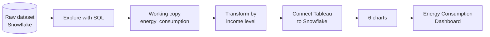

<div align="center">


<br/>


</div>

---

## 📖 Overview

This project analyzes **household renewable energy data** across **25 countries and 6 regions**. The data lives in **Snowflake**, is transformed with **SQL** by income level, and is visualized in a **Tableau dashboard** that compares energy usage (**KWH**) and cost savings (**CSU**, Cost Savings USD) by country, region and energy source.

<div align="center">


</div>

---

## 🔄 Workflow



---

## 🗃️ Dataset

Table: `tableau.tableau_Data.tableau_dataset`

| Column | Description |
|---|---|
| `HOUSEHOLD_ID` | Unique household identifier |
| `COUNTRY` | Country of the household |
| `REGION` | Region (Africa, Asia, Australia, Europe, North America, South America) |
| `URBAN_RURAL` | Urban or rural household |
| `HOUSEHOLD_SIZE` | Number of people in the household |
| `INCOME_LEVEL` | Low, Middle or High |
| `ENERGY_SOURCE` | Wind, Hydro, Solar, Biomass or Geothermal |
| `ADOPTION_YEAR` | Year the energy source was adopted |
| `YEAR` | Reporting year |
| `MONTHLY_USAGE_KWH` | Monthly energy usage in kWh |
| `COST_SAVINGS_USD` | Cost savings in US dollars |
| `SUBSIDY_RECEIVED` | Whether a subsidy was received |

---

## 🧮 SQL Transformations

All queries are in [`queries.sql`](queries.sql).

| Step | What it does |
|---|---|
| **Explore** | Row counts, preview with `LIMIT 20`, counts by `REGION` and `INCOME_LEVEL` |
| **Working copy** | `CREATE OR REPLACE TABLE energy_consumption AS SELECT * ...` |
| **Usage adjustment** | `MONTHLY_USAGE_KWH` raised by income level: **Low +10%**, **Middle +20%**, **High +30%** |
| **Savings adjustment** | `COST_SAVINGS_USD` reduced by income level: **Low -10%**, **Middle -20%**, **High -10%** |

```sql
UPDATE tableau.tableau_Data.tableau_dataset
SET MONTHLY_USAGE_KWH = MONTHLY_USAGE_KWH * 1.1
WHERE income_level = 'Low';
```

> ⚠️ **Heads up:** the `UPDATE` statements multiply the values again every time they run, so run them **once**. The backup table `energy_consumption` is created *before* the updates, so it keeps the original values, while the dashboard reads the adjusted `tableau_dataset`.

---

## 📊 Dashboard Views

| # | Chart | Shows |
|---|---|---|
| 1 | **KWH Country** | Energy usage by country |
| 2 | **CSU Country** | Cost savings by country |
| 3 | **KWH Energy Source** | Energy usage by source |
| 4 | **CSU Energy Source** | Cost savings by source |
| 5 | **KWH Region** | Energy usage by region |
| 6 | **CSU Region** | Cost savings by region |

---

## 🔍 Key Insights

### 🌍 By country
| | KWH | CSU |
|---|---|---|
| 🥇 **Highest** | Australia (80,410) | New Zealand (13,040) |
| 🥈 **Second** | New Zealand (65,414) | Australia (11,195) |
| 🥉 **Third** | Canada (52,109) | Canada (7,331) |
| ⬇️ **Lowest** | Chile (16,556) | UK (2,181) |

### ⚡ By energy source
| Source | KWH | CSU |
|---|---|---|
| 💨 Wind | **214,492** (highest) | **32,345** (highest) |
| 💧 Hydro | 184,101 | 24,542 |
| ☀️ Solar | 179,372 | 28,508 |
| 🌱 Biomass | 177,981 | 26,797 |
| 🌋 Geothermal | 164,182 | 24,639 |

### 🗺️ By region
- **Highest KWH:** Europe (163,213), followed by Africa (156,366) and South America (156,148)
- **Highest CSU:** Africa (25,722), followed by Australia (24,236) and South America (23,136)
- **Lowest CSU:** North America (20,053)

### 💡 Takeaways
- **Wind** leads in both usage and savings, making it the strongest source in this data.
- **Australia** and **New Zealand** stand out on both measures, even though their KWH ranking and CSU ranking are in a different order.
- **Europe** uses the most energy by region but is not the top region for savings, which belongs to **Africa**.

---

## 🛠️ Tech Stack

| Layer | Tool |
|---|---|
| Data warehouse | Snowflake |
| Data transformation | SQL |
| Visualization | Tableau |
| Version control | Git and GitHub |

---

## 📁 Repository Structure

```
Energy-Consumption-Dashboard-Tableau-Snowflake
├── queries.sql            # Snowflake SQL: exploration and transformations
├── Tableau_Dashboard.twb  # Tableau workbook
├── Dashboard.png          # Dashboard screenshot
├── LICENSE                # MIT License
└── README.md              # Project documentation
```

---

## 🚀 How to Explore

1. Open [`queries.sql`](queries.sql) to see the SQL steps.
2. Download the `.twb` file and open it in **Tableau Desktop**.
3. Reconnect the workbook to your own Snowflake dataset if you want live data.

> **Note:** The workbook needs access to the Snowflake data source. Without it, use the screenshot above to see the finished dashboard.

---

## 🧠 Skills Demonstrated

- Querying and transforming data in Snowflake with SQL
- Conditional updates by category (income level)
- Building multi-view dashboards in Tableau
- Turning data into clear, business-ready insights

---

<div align="center">

### 👤 Author

**Zakariya Gezali**, Data Analyst

[](mailto:gezalizakariya94@gmail.com)
[](https://github.com/gezali)

⭐ If you found this project useful, consider giving it a star.


</div>
